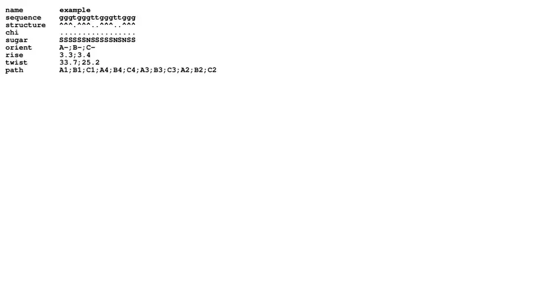
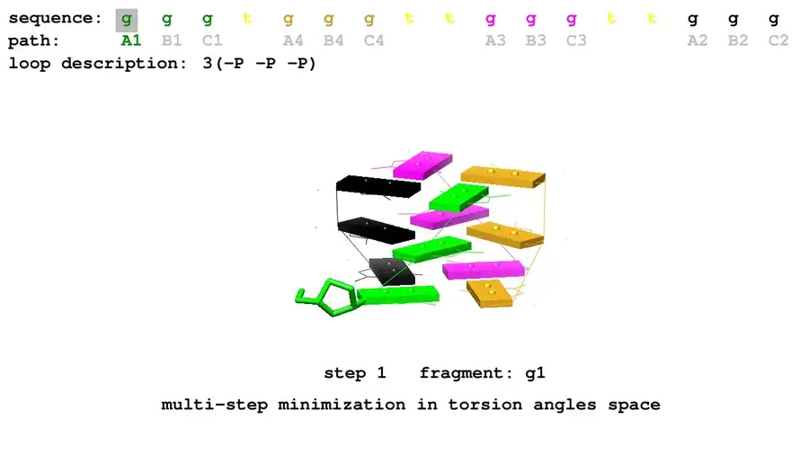

# quadro

**Knowledge-based 3D structure generation for G-quadruplexes.**

quadro builds an atomic model of a G-quadruplex from a topological description:
which residues form which tetrad, in which glycosidic orientation, stacked with
what rise and twist. It assembles the molecule residue by residue in torsion
space with CYANA, then refines it in Cartesian space with Xplor-NIH.

Engine version in this repository: **16** (see `VERSION`).  Version 16 is the
archived engine used for the manuscript measurements.

> ### ⚠ Two dependencies are not included and cannot be
>
> quadro drives **CYANA 2.1** (commercial licence) and **Xplor-NIH 2.39** (free
> for non-profit institutions). Both licences forbid passing the software on to
> third parties, so neither is in this repository and neither may be baked into
> a publicly pullable Docker image. You install both yourself, once.
>
> **→ [docs/THIRD-PARTY.md](docs/THIRD-PARTY.md)** — where to get them, where to
> put them, what the licences say.

---

## Quick start

```bash
git clone https://github.com/mkdewe/quadro.git
cd quadro

# 1. Install the two licensed dependencies (see docs/THIRD-PARTY.md)
#    → third_party/cyana-2.1/
#    → third_party/xplor-nih-2.39/
tools/check-third-party.sh

# 2. Build the image (Docker 23+ / buildx required)
tools/build.sh

# 3. Run an example
tools/run.sh --outdir out examples/6a-1hap_js12B.inp
```

`Etotal` in the energy file is the figure to compare when ranking several models
of the same sequence — lower is better.

Reference results for all three examples, and the environment that produced
them, are in [`examples/reference/`](examples/reference/) — compare against
those to check a fresh installation.

### One handedness per run

A topology specified through `orient`, `rise`, `twist` and `path` does not
determine the handedness of the stack. The opposite reading produces a
sterically plausible structure that differs only in energy, so the ambiguity
cannot be resolved by inspection of the model.

Engine 16 builds one handedness per invocation. The mirror input is produced by
inverting the signs in `orient`, `rise` and `twist` and exchanging positions 2
and 4 in every `path` token; run it as a second job and compare `Etotal`. The
transformation is specified in
[docs/ALGORITHM.md](docs/ALGORITHM.md#the-mirror-pass). `--no-mirror` is accepted
for compatibility and changes nothing, because there is no built-in mirror pass
in this engine.

Without the wrappers:

```bash
docker run --rm -v "$PWD:/work" quadro:latest examples/7ys7.inp
docker run --rm -v "$PWD:/work" quadro:latest --help
```

---

## Input

One plain-text `.inp` file per structure — `keyword value`, one per line, order
irrelevant. This is `examples/6pnk.inp`, the three-tetrad DNA G-quadruplex used
in the animations above:

```
name        6pnk
sequence    gggtgggttgggttggg
structure   ^^^.^^^..^^^..^^^
chi         .................
sugar       SSSSSSNSSSSSNSNSS
orient      A-;B-;C-
rise        3.3;3.4
twist       33.3;24.2
path        A1;B1;C1;A4;B4;C4;A3;B3;C3;A2;B2;C2
test        y
rm_level    5
iteration   100
```

Field by field:

**`name`** — base name for the output. This run writes `6pnk.pdb` and
`6pnk_energy.txt`.

**`sequence`** — the nucleotides. **Case selects the sugar, the letter selects
the base:** uppercase `ACGTU` is RNA (ribose), lowercase `acgtu` is DNA
(deoxyribose). All ten combinations are meaningful — uppercase `T` is
ribothymidine, lowercase `u` deoxyuridine — and mixing cases gives a chimeric
molecule.

**`structure`** — which residues form tetrads. Same length as `sequence`. Two
notations exist, and the presence of a `^` anywhere selects between them. Here
each `^` marks a tetrad residue and the column assignment is taken entirely
from `path`; the alternative is to write the column letter (`A`, `B`, `C`) in
place of each `^`. `.` is an unpaired loop or overhang, and dot-bracket
characters `()[]{}<>` may also appear, for canonical base pairs in a duplex
region.

**`chi`** — glycosidic torsion per residue: `S` *syn*, `A` *anti*, `.` let the
engine decide. All dots here, so the engine chooses throughout.

**`sugar`** — sugar pucker per residue: `N` North (C3′-endo, RNA-like), `S`
South (C2′-endo, DNA-like), `.` the default for that residue's sugar type. Omit
the line to accept the defaults everywhere.

**`orient`** (polarity) — hydrogen-bond directionality, one entry per tetrad, in
tetrad order — three tetrads here, all `-`. `+` is Watson-Crick/Hoogsteen, `-`
is Hoogsteen/Watson-Crick. The letter must match the tetrad's position: `A` for
the first, `B` for the second, `C` for the third. This is what the animations
below label *polarity*, `G4plus` and `G4minus`.

**`rise`** — displacement along the stack axis, in ångströms. One value, or one
per step, as here: `3.3` from tetrad A to B, `3.4` from B to C. **Signed:** the
first tetrad sits at *z* = 0 and every later one is placed at the running sum of
the steps before it, so a value says where the next tetrad goes *relative to the
first*, not how far apart two neighbours are. Negative values are ordinary —
`examples/7ys7.inp` stacks downwards first with `rise -3.8;6.7`.

**`twist`** — rotation about the same axis, in degrees, accumulated the same way
from an unrotated first tetrad, and signed for the same reason: the two signs
are opposite senses of rotation. Roughly 30° for parallel stacks, 15–20° for
antiparallel.

**`path`** — **the build-up order, and a real parameter of the method.** The
molecule is assembled one residue at a time in exactly this sequence, with a
CYANA minimisation after each. `4 × number of tetrads` entries — twelve here;
each group of four must complete one tetrad. The same topology built in a
different order is a different calculation with a different result.

**`test`** — `y` keeps the engine verbose and preserves diagnostic output; `n`
for production runs.

**`rm_level`** — how much CYANA/Xplor scratch to delete afterwards. `5` removes
everything, `0` keeps it all — set `0` when a run fails and you need to see why.
It has **no effect on the resulting geometry or energy**.

**`iteration`** — CYANA minimisation steps at each build-up stage; minimum 10,
default 300. **It sets the starting point, not the answer:** it decides how
well-relaxed a structure the Cartesian refinement receives, and 2000 Xplor-NIH
steps follow regardless. More is therefore not monotonically better: a deeper
build-up fixes some structures and breaks others. The useful move is to run
several depths and keep the lowest `Etotal`.

A line that is neither a keyword, a comment nor blank is rejected outright
(`ERROR 26`) rather than ignored — a misspelt field used to pass silently and
leave the run using the default.

Full reference, including the labelled `structure` notation, the optional
`my_angles` field and the error table:
**[docs/INPUT-FORMAT.md](docs/INPUT-FORMAT.md)**.

---

## How it works

```
 .inp ──▶ parse & validate ──▶ ideal tetrad geometry ──▶ CYANA deck ──▶ CYANA
                                  (tetrad.lib)                            │
                                                                          ▼
 .pdb ◀── xplor2pdb2.exe ◀── Xplor-NIH pass 2 ◀── Xplor-NIH pass 1 ◀── cyana2xplor.exe
```

| Stage | Program | Space | Steps |
|---|---|---|---|
| Build-up, once per residue in `path` order | CYANA | torsion angles | `iteration` each |
| Closing pass | CYANA | torsion angles | 100 |
| Refinement 1 — tetrad core frozen | Xplor-NIH | Cartesian | 1000 |
| Refinement 2 — all released, planar + dihedral + NOE restraints | Xplor-NIH | Cartesian | 1000 |

One invocation runs the sequence once. The mirror input, when wanted, is a
separate job; see [the mirror pass](docs/ALGORITHM.md#the-mirror-pass).

**[docs/ALGORITHM.md](docs/ALGORITHM.md)** describes each stage, with the
relevant lines of the engine quoted.

**Stage 1 — ideal tetrad geometry.** Tetrad polarity (`orient`), the
pseudo-atoms and the rotation about the N9–C1′ bond, the pseudo-residue **Q**,
and the stacking of three tetrads by `translate z` and `rotation z` — that is,
by `rise` and `twist`, both measured from the first tetrad and therefore signed.



**Stage 2 — build-up in torsion space.** From the bare quadruplex core to the
final structure, one fragment at a time. The `path` bar along the top
highlights each token as its residue is added.



Both animations run at 5× speed. The source films, and the mapping between
their G4Composer interface labels and the `.inp` keywords, are in
[docs/media/](docs/media/).

---

## Repository layout

```
engine/         the engine and its data libraries — copied verbatim into the image
docker/         Dockerfile and container entrypoint
tools/          build / run / dependency-check wrappers
docs/           input format, algorithm, third-party setup
docs/media/     animations of the first two stages
examples/       example inputs and reference outputs
third_party/    empty — you install CYANA and Xplor-NIH here
```

`engine/*.exe` are AWK and shell scripts, not Windows binaries. The extension is
the author's convention; the files are plain text and meant to be read.

---

## Requirements

- Linux or macOS with Docker **23+** (or `buildx` — named build contexts are
  required by the build)
- ~4 GB of disk for the image, most of it Xplor-NIH
- A CYANA 2.1 licence and an Xplor-NIH download

Running natively on Linux, without the container, is documented in
[docs/THIRD-PARTY.md](docs/THIRD-PARTY.md#option-b--native-linux). Docker is
recommended because the Dockerfile is the canonical record of the environment —
the 32-bit runtime libraries CYANA 2.1 needs, the GNU awk requirement, and the
Xplor-NIH layout are all easy to get subtly wrong by hand.

---

## Citation

If you use quadro, please cite the software (see `CITATION.cff`, or the "Cite
this repository" button on GitHub) **and** both dependencies, as their licences
request:

> C. D. Schwieters, J. J. Kuszewski, N. Tjandra, G. M. Clore, "The Xplor-NIH NMR
> Molecular Structure Determination Package," *J. Magn. Reson.* **160**, 66–74 (2003).
>
> P. Güntert, "Automated NMR structure calculation with CYANA,"
> *Methods Mol. Biol.* **278**, 353–378 (2004).

---

## Licence

MIT for everything in this repository — see [`LICENSE`](LICENSE).

The MIT grant covers quadro itself only. CYANA and Xplor-NIH are separately
licensed, are not part of this repository, and are not covered by it.
